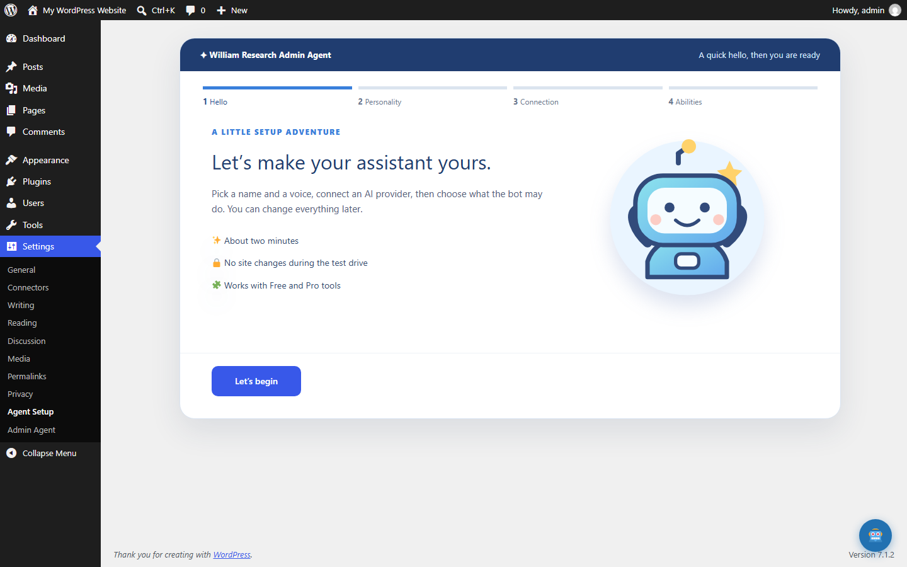
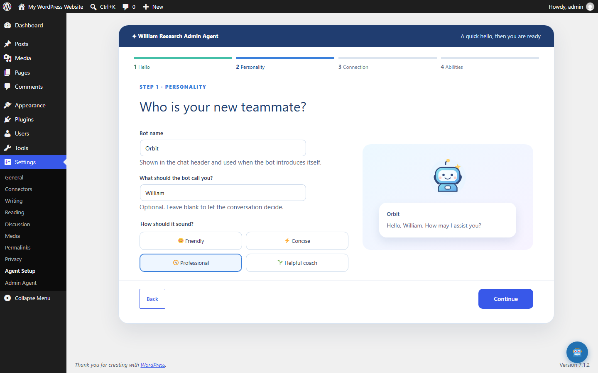
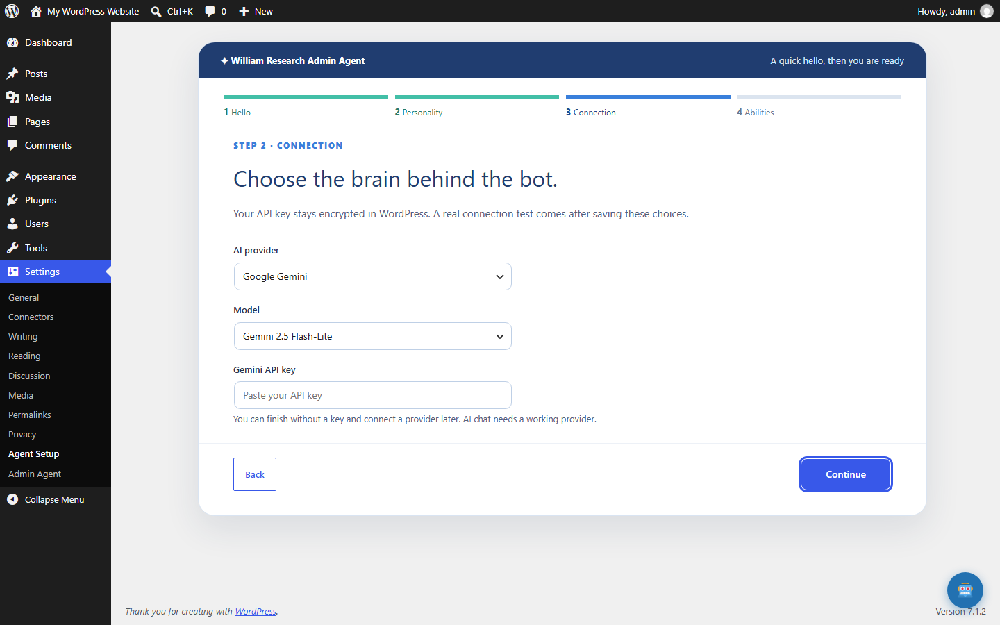
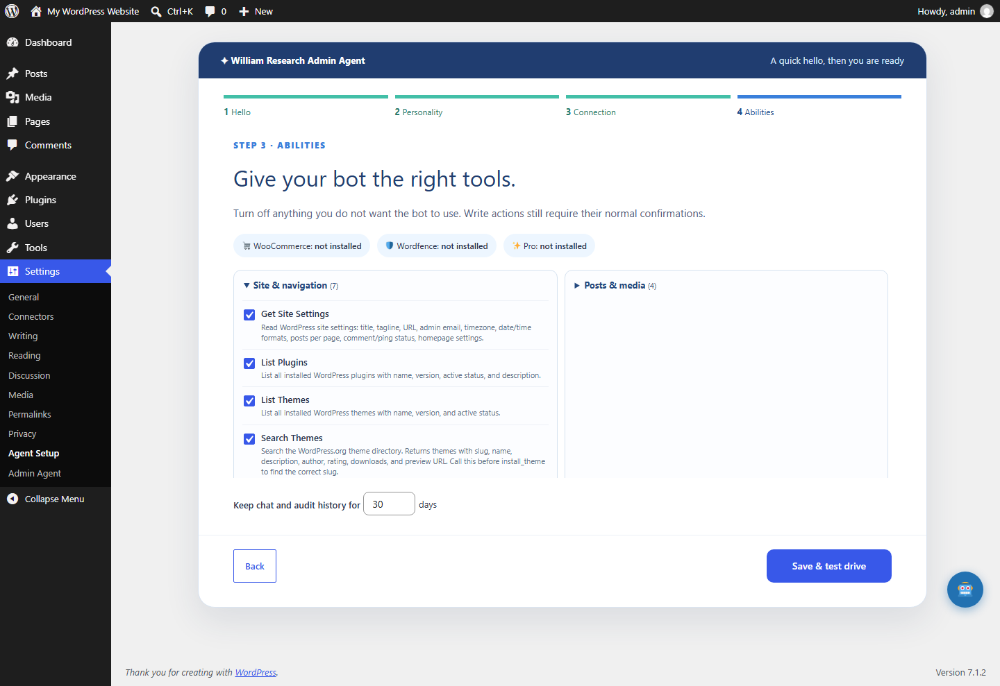
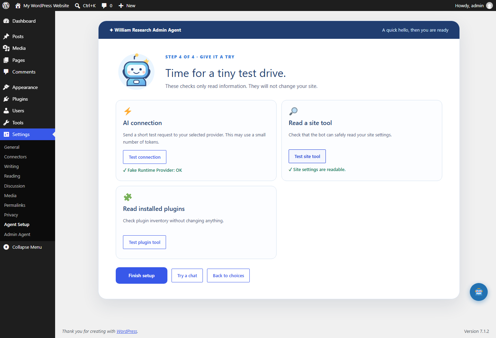
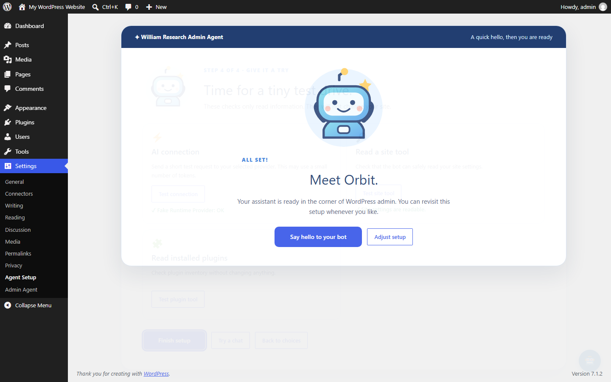
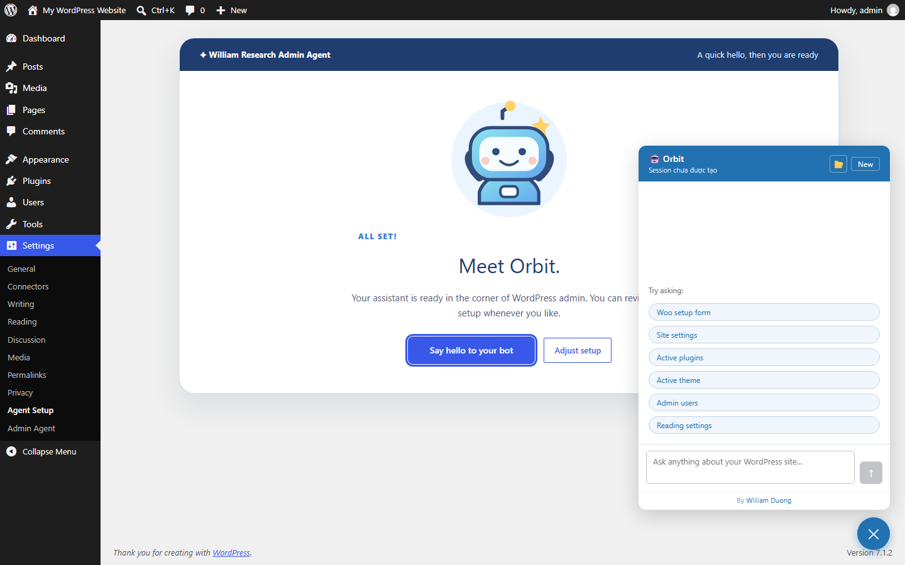

# Xem trước wizard thiết lập Admin Agent 0.5.0

Các ảnh dưới đây được chụp từ plugin chạy thật trong WordPress Playground 7.1.2, ở kích thước trình duyệt 1440 × 900. Tên bot **Orbit** và tên người dùng **William** chỉ là dữ liệu minh họa. Ảnh kết nối hiển thị Gemini để thấy trường API key; phần thử nghiệm sau đó dùng provider giả lập của môi trường local nên không cần khóa thật và không gọi dịch vụ AI bên ngoài.

Sau khi kích hoạt plugin lần đầu, quản trị viên được đưa vào wizard. Về sau có thể mở lại tại **Settings → Agent Setup**.

## 1. Màn chào

Wizard giới thiệu bốn phần: làm quen, cá tính, kết nối và khả năng của bot. Nhấn **Let’s begin** để bắt đầu.

## 2. Đặt tên và phong cách

Nhập tên bot, cách bot gọi bạn (có thể để trống), rồi chọn **Friendly**, **Concise**, **Professional** hoặc **Helpful coach**. Bên phải có lời chào mẫu thay đổi ngay theo lựa chọn. Tên bot sẽ xuất hiện trên cửa sổ chat; cách xưng hô và phong cách được đưa vào hướng dẫn cho mô hình AI.

## 3. Chọn kết nối AI

Chọn Anthropic, Gemini hoặc Ollama; chọn model rồi nhập khóa hoặc địa chỉ máy chủ tương ứng. Khóa đã lưu không được hiển thị lại. Có thể đi tiếp khi chưa có khóa và bổ sung sau, nhưng chat AI cần kết nối hoạt động.

## 4. Chọn những gì bot được làm

Các tool được nhóm theo site, bài viết/media, cửa hàng và bảo mật. Bỏ chọn tool không muốn bot sử dụng. Wizard cũng hiển thị tình trạng WooCommerce, Wordfence và Pro, cùng số ngày giữ hội thoại và nhật ký. Những hành động ghi dữ liệu vẫn đi qua cơ chế xác nhận của plugin.

## 5. Thử trước khi hoàn tất

Nhấn **Save & test drive**, rồi thử kết nối AI và các tool chỉ đọc. Bài thử tool không thay đổi website. Bài thử kết nối gửi một yêu cầu ngắn tới provider đã chọn; với provider thật, yêu cầu này có thể dùng một ít token.

## 6. Hoàn tất và mở bot

Nhấn **Finish setup**. Màn cuối xác nhận tên bot và cho phép mở chat ngay hoặc chỉnh lại các lựa chọn.

## Các điểm nên xem khi duyệt

- Wizard có đủ ngắn, dễ hiểu cho người mới cài plugin không?
- Tên bước, lời giải thích và hình bot có hợp với phong cách sản phẩm không?
- Nhóm tool và các nút thử có giúp người dùng hiểu rõ quyền của bot không?
